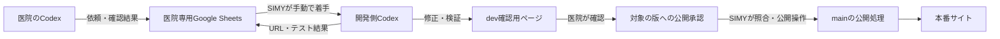

# SIMY向け：ホームページ管理の初期設定・運用手順

更新日：2026-10-30。対象はSIMY管理リポジトリ・AWSで配信する静的サイト。
サンプル試験に参加する医院には[Codexによるサンプル受付テスト手順](hp-management-customer-guide.md)を渡す。
初めて設定する担当者は、[設定の順序と役割の一覧](hp-management-start-here.md)から読む。

## この手順書の対象と、通常ChatGPT受付の位置付け

この文書が扱うのは、現在動かせる**Codex + Google Sheetsによるサンプルの手動試験**
です。実医院にこの設定を配布して運用開始してはいけません。

| 経路 | 設定する人 | 現在の状態 |
| --- | --- | --- |
| Codex + Google Sheets | 医院とSIMY担当者 | サンプル限定で試験済み。担当者が手動で着手する。 |
| 通常のChatGPTからのHP受付 | 技術設定はSIMY、本人認証は医院 | 準備中。医院にCodex、ローカルスキル、Google/GitHub/AWS設定を求めない構成にする。HP受付プラグインの配布、利用者登録の運用画面、Sheet/dev連携、メール通知は未提供。 |

通常ChatGPTの将来経路では、SIMYがサーバー側にサイト、許可利用者、許可された
repo/AWS/Sheet参照、通知先を登録する。顧客の入力やシートのセルをこれらの権限の
根拠にしない。初回の本人認証とHP限定の同意は必要であり、顧客に何の操作も求めない
ことを現時点で約束しない。

2026-10-30の配備記録では、医院・利用者の認可、確認用提案、受付WorkFlowの保存・
状態読戻しを担う基盤はdevへ反映済み。Backendの実スキーマとCrewの配信revisionを
確認し、HP機能は既定OFFのまま維持した。8件同時送信の重複防止、権限取消、
本文改変、別医院へのアクセス拒否は合成アカウントによる隔離環境の試験で確認した。
実医院の登録、通常ChatGPTからの利用、Sheets・開発実行・配信への接続は未完了。
この基盤は下記のCodex＋Sheets手動経路にまだ接続されていない。
配備対象は[Backend PR #1587](https://github.com/SpecialistDoctors-Inc/simy-backend/pull/1587)と
[Crew PR #2997](https://github.com/SpecialistDoctors-Inc/simy-crew/pull/2997)。

## 1. 現在できることと、利用開始の条件

医院側Codexが要望を整理してGoogle Sheetsへ登録し、開発側Codexが読み取り、
devへ反映して結果を同じシートに返す構成。受付と実装の間をシートで受け渡す。
**現在利用できるのは、担当者が進行するサンプル試験の経路。**
スキルを入れるだけで医院向けの自動運用が始まる構成ではない。



| 項目 | 現在の状態 |
| --- | --- |
| 新規ローカル環境でのCodexログイン・受付スキル導入 | Docker内のCLIで試験済み |
| 実シートへの依頼追記・開発側読取・結果追記・医院側読戻し | サンプル限定の手動設定で試験済み |
| devへの反映とPC・スマートフォン表示確認 | サンプルで試験済み |
| 本番公開経路 | 承認されたdev成果物をmainの手動workflowで公開する構成を用意。今回の初期設定試験では未実行 |
| 医院・利用者の受付基盤 | dev配備記録あり、HP機能は既定OFF。登録用の運用画面・実医院の受入は未提供 |
| シート・repo・AWS・開発実行との対応登録 | 未接続。実医院の自動運用開始前に必要 |
| 顧客と開発者のGoogle権限分離 | 別OAuth接続が必要。今回の試験では同一管理Googleアカウントを使用 |
| 受付後の自動起動・開発実行 | 未接続。受付基盤には重複制御と永続WorkFlowがあるが、配信未設定の状態で止まる。Sheets経路は担当者が手動で進行 |
| 確認依頼・公開完了のメール通知 | 未接続・未送信 |

アプリのインストーラー操作と未連携Googleアカウントの初回OAuthは未検証。
試験で使ったChatGPTアカウントの既存Google接続が新環境に復元された。
再現手順と検証範囲は[ゼロ設定からの試験記録](hp-management-zero-setup-test.md)を参照する。

## 2. SIMYが医院ごとに用意する情報

管理対象は非公開の管理台帳で確認する。共有シートや依頼本文に書かれたURLから
リポジトリ・AWSアカウント・通知先を決定しない。次の表は収集項目であり、
そのまま読み込んで全経路を設定するファイルや登録APIはまだ存在しない。
受付基盤にあるサイト・利用者の登録テーブルだけでは、下記の配信先や通知先まで設定できない。

| 項目 | 決める内容 | サンプルの値／記入例 |
| --- | --- | --- |
| `site_id` | 変わらない管理対象ID | `sample-clinic` |
| 医院名・担当者 | 本人確認と契約上の依頼権限 | `<SIMYが確認した医院と担当者>` |
| `requester_ref` | 確認済み利用者への参照 | `<登録サービスが発行する参照>` |
| スプレッドシート | 医院専用URL・ID・タブID | `<医院専用Sheet>` |
| Google接続 | 医院側／開発側それぞれの実プロフィールIDと権限 | `<各接続で読み戻して確認>` |
| リポジトリ・対象パス | 許可された変更範囲 | `SpecialistDoctors-Inc/simy-home` / `examples/sample-clinic/` |
| ブランチ | 確認用／公開処理用 | `dev` / `main` |
| 確認用URL | 開発結果を確認する場所 | `https://sample-clinic-dev.simy.one` |
| 本番URL | 公開先。公開済みかは別途確認 | `https://sample-clinic.simy.one` |
| AWS・配信設定 | アカウント、各環境のS3・CloudFront・OIDC role | Terraform出力と実環境を照合 |
| 公開承認者 | 医院の意思決定者、SIMYのEnvironment reviewer | `<本人・権限を確認>` |
| `notification_recipient_ref` | 確認済みメール通知先への参照 | `<受信者を確認後に登録>` |
| 通知状態 | 利用する送信元・provider・有効化状況 | 現在は未接続・送信無効 |
| 運用窓口 | 手動着手の依頼先と引き継ぎ方法 | `<担当者・連絡経路>` |

個人情報、実シートURL、認証情報、承認の原文を公開リポジトリに保存しない。
医院へ渡す利用開始情報は、この台帳から必要事項だけを抜き出す。

## 3. 医院専用Google Sheetsを作る

1. SIMY管理のGoogleアカウントで、医院ごとにネイティブGoogle Sheetsを作る。
   テンプレートをコピーする場合は、過去の依頼・イベントを含まないものを使う。
2. タブを `ご利用ガイド`、`Requests`、`Events` の3つにする。
3. `Requests` と `Events` の1〜3行目は説明、4行目は下記の見出しにする。
   運用データは5行目から。見出しの名前・順序を変えない。
4. 医院の確認済みGoogleアカウントと、SIMY開発側のGoogleアカウントへ
   編集権限を付与する。リンクを知っている全員への編集公開は使わない。
5. 医院側・開発側の各接続で、プロフィール・シート名・タブ・見出しを読み戻す。
   ブラウザーでの表示確認だけで接続完了としない。

以下はタブ区切り。各シートの **A4** に貼り付けられる。

Requests（A4:N4）：

```tsv
request_id	revision	site_id	outcome	target	effective_at	expires_at	timezone	assets_rights	dependencies	acceptance	requester_ref	notification_recipient_ref	proposal_state
```

Events（A4:I4）：

```tsv
event_id	request_id	revision	occurred_at	actor	kind	body	reply_to_event_id	event_idempotency_key
```

`ご利用ガイド` には、医院名、用途、SIMY窓口、手動着手の依頼方法、現在の通知状態、
確認用と本番の違いを書く。例文は説明として置き、依頼データとして混ぜない。
見出しの保護は誤編集防止には使えるが、利用者の本人確認や公開承認を証明しない。

記録規約は[スプレッドシート契約](hp-management-spreadsheet-workflow.md)に従う。
依頼の変更は新しいrevision、質問・回答・結果はEventsへ追記する。
`proposal_state` の書換えで他者の進行状態を管理しない。
API追記には値を文字列・数値として扱う `appendCells` / `userEnteredValue` を使い、
数式として入力しない。固定IDで追記前後を照合し、応答不明なら再送前に読戻す。

## 4. 医院・利用者と対象を結び付ける

**ここが実医院向けの利用開始に残っている実装項目。** 受付基盤のサイト・利用者認可は
実装済みだが、医院用の登録画面と、シート・開発実行・配信先を結ぶ登録は未提供。
医院がシートを編集できることと、その人が医院の更新や公開を依頼できることは
別々に確認する。Googleのプロフィール文字列や入力されたメールだけで後者を
認めない。

本サービスでは、SIMYが確認した利用者と `site_id`、専用シート、許可された操作を
管理サービスに登録し、Codexがその対応を認証付きで取得できるようにする。
リポジトリ・AWS・通知先はこの管理情報から解決する。編集可能なシートのセルや
端末上の任意JSONファイルを権限の根拠にしない。

### 現在のサンプル試験を進める場合

登録サービスの代わりに、担当者が対象と範囲を確認した**試験専用の手動設定**を
その試験セッションへ渡す。これは実医院向けの登録方法ではなく、受付スキルの
通常条件を満たしたと報告しない。

1. SIMY担当者が、管理台帳の対象、接続プロフィール、シート共有、試験依頼者を照合する。
2. 当該セッションに、確認したサイトID・シート・接続ID・依頼者参照・対象URL・
   許可する操作を、非公開の試験記録を参照して渡す。
3. 許可を「1件の試験依頼の登録・読戻し」「手動開発」「dev反映」「結果追記」の
   必要な範囲に限定する。受付役と開発役のチャットを分ける。
4. 同一管理アカウントを両役で使うなら、その例外と未検証の権限分離を記録する。
5. 実医院の依頼、無人実行、本番公開、メール送信をこの試験設定に含めない。

サンプル試験での手動設定を依頼する文面：

```text
今回はSIMY管理者が監督するサンプル限定の手動試験です。
医院登録サービスと永続的な業務runnerは未接続として扱ってください。
以下を、私が管理情報と実際のGoogle接続から照合済みの試験対象として渡します。
site_id: sample-clinic
専用Sheet: <今回照合したシートURL>
Google接続プロフィールID: <今回確認したID>
依頼者参照: <この試験の確認記録に対応する参照>
リポジトリ: SpecialistDoctors-Inc/simy-home
変更対象: examples/sample-clinic/
確認用: https://sample-clinic-dev.simy.one
許可範囲: <この役割に許可する操作を列挙>

接続プロフィール・シート・対象が一致することを読取で確認し、合わなければ停止してください。
試験用の手動設定を、本サービスの本人確認・永続claim・権限分離の成功と報告しないでください。
本番公開とメール送信は許可範囲に含めません。
```

この文面中の自己申告を本人確認の代用にしない。担当者が実際に照合した後だけ
使う。試験中は担当者1名が対象依頼を進行し、並行ワーカーを動かさない。

## 5. サンプル試験用に医院側Codexを設定する

[Codexによるサンプル受付テスト手順](hp-management-customer-guide.md)の1〜4を案内する。
医院側に渡すのは `hp-customer-intake`。確認項目は次の4つ。

- 本人のChatGPTアカウントでCodexが応答する。
- Google Drive接続が、シート共有先のGoogleアカウントと一致する。
- 受付スキルと同梱の `references/workbook-contract.md` を読める。
- 確認済みの対象を解決できる。サンプル試験では手順4の例外を明記する。

GitHub/AWSの管理認証や開発用リポジトリを医院の端末に配らない。
スキルの固定版はサンプル試験の再現用。更新版を配布する場合は、版を固定して
別途確認し、既存の同名スキルを無断で上書きしない。

## 6. SIMY開発側のCodexを設定する

1. SIMYの開発用環境でCodexを起動する。医院のアカウントを借用しない。
2. 開発側のGoogle Drive接続を用意し、専用シートを読めることを確認する。
   実医院向けには医院側と別OAuth接続を使う。
3. 次の文面で開発用スキルを導入し、新しいチャットで認識を確認する。

```text
SIMYの開発担当用hp-developer-deliveryスキルをインストールしてください。
取得元は SpecialistDoctors-Inc/simy-home、
リビジョンは 80a04f7f3fe143df06767a4ae1eaf786e1297519、
パスは examples/hp-management/skills/hp-developer-delivery です。
公式のskill-installerが利用できれば使用し、同梱referencesも導入してください。
既存の同名スキルは無断で上書きしないでください。
インストールだけを行い、依頼処理・公開・メール送信はまだ開始しないでください。
```

4. GitHub認証のアカウントと対象リポジトリを確認する。依頼実装には専用worktreeを使う。
5. サンプルのAWS/GitHub設定は次節に従う。AWSの配信操作はGitHub Actionsの
   OIDC roleを使用し、共有シートにAWSキーを保存しない。

開発スキルも通常は信頼できる登録と永続claimを要求する。未実装の状態で
「スキル導入済みだから無人実行可能」と扱わず、サンプル試験は手順4で明示する。

## 7. dev・本番の配信設定を用意する

これは**サンプルクリニック専用**の構成。他の医院へ展開する場合は、その医院の
リポジトリ・AWS・ドメインを確定してから別途構成する。
既存サンプル環境を再作成せず、まず現状を読み取る。

正確なTerraform手順と出力名は[配信手順](sample-clinic-deployment.md)を参照する。
同手順のAWSアカウント・state・workspaceと実際の対象を照合してから変更する。

| 設定 | dev | 本番 |
| --- | --- | --- |
| GitHub Environment | `sample-clinic-dev` | `sample-clinic-prod` |
| 許可するブランチ | `dev` | `main` |
| 実行契機 | 対象パスのdev更新／dev手動実行 | mainからの明示的な手動実行のみ |
| Environment reviewer | 運用に合わせる | 必須。医院の承認対象を照合する |
| 管理者による保護の迂回 | — | 無効。`can_admins_bypass=false` を読戻す |

各Environmentに、対応するTerraform出力から次のSecretsを設定する。

| GitHub Secret | Terraform出力 |
| --- | --- |
| `AWS_SAMPLE_CLINIC_DEPLOY_ROLE_ARN` | `site_deploy_role_arn` |
| `SAMPLE_CLINIC_S3_BUCKET` | `s3_bucket_name` |
| `SAMPLE_CLINIC_CF_DISTRIBUTION_ID` | `cloudfront_distribution_id` |

本番の保護・Secretsを確認後、リポジトリ変数
`SAMPLE_CLINIC_PRODUCTION_ENABLED=true` を設定する。
**mainへのpushやマージだけで、サンプルの本番サイトは公開されない。**
既存のSIMYホームページ用 `deploy-site.yml` とは別のworkflowを使う。

mainに `.github/workflows/deploy-sample-clinic.yml` と、その実行で使う
`examples/sample-clinic/` の公開処理（`release.mjs`・`publish.sh` など）が
存在することも確認する。未導入なら、サンプルに必要なファイルだけを対象にした
別PRでレビュー・導入する。リポジトリ全体のdevをmainへマージして、無関係な
変更まで取り込まない。既存サンプル環境では、導入済みかを先に読み戻す。

## 8. 依頼を受け、devへ反映する

1. 医院側が依頼を登録し、依頼ID・revision・`ready_for_dev` を読戻す。
2. SIMY担当者が開発側Codexへ対象の依頼を明示する。現状は自動起動しない。
3. 開発側は最新revision、質問・回答、合格条件、対象との対応を読む。
   不足があれば質問を返す。サンプルの手動試験か、本サービスの実行かも確認する。
4. 専用worktreeで依頼された範囲を変更し、テストとレビューを行う。
   サンプルの本文は `examples/sample-clinic/content/clinic.json`。
   同ファイルの `changeRequest.id` と `changeRequest.revision` も対象依頼に合わせる。
5. 許可されたdev向けPR・マージを進め、GitHub Actionsのデプロイ完了を確認する。
6. 配信された `version.json`、変更箇所のPC・スマートフォン表示、成果物の一致を確認する。
7. `test_result` と `dev_preview_ready` を追記し、医院側の新しいセッションで読戻す。

サンプルのローカル確認コマンド（リポジトリのルートで実行）：

```sh
node examples/sample-clinic/build.mjs
node --test examples/sample-clinic/tests/*.test.mjs
```

開発側への手動着手メッセージ例：

```text
hp-developer-deliveryを参照し、確認済みの対象情報に従って、
依頼ID <依頼ID>、revision <番号> をdev確認用ページに反映してください。
今回は事前に範囲を確認したサンプルの手動試験です。
専用worktreeで実装し、テスト・レビュー・dev向けPR・マージ・配信確認まで進めてください。
実際のdevページをPC・スマートフォンで操作し、合格条件を確認してください。
依頼ID、revision、URL、source SHA、artifactHash、artifact ID、テスト結果を
専用シートへ追記し、読戻してください。本番公開とメール送信は含めません。
未実装の業務runnerや永続claimを実行済みと報告しないでください。
```

この文面はdev向けPR・マージも依頼するため、SIMY担当者がその権限と対象を
確認して使う。メールの自動通知は行われないので、医院へ確認用URLを渡す作業を
担当者が引き継ぐ。Codexに連絡送信まで任せる場合は、宛先と送信内容も明示する。

## 9. 承認された版を本番へ公開する

現在のサンプルでは、手順4のdev試験と別に、本人が依頼した公開試験として実施する。
この手順書の作成自体は公開指示ではない。実医院には登録・承認サービスの実装と
受入試験後に適用する。同一管理Googleアカウントのサンプル試験を、医院の独立した
本人確認の成功として扱わない。

1. SIMYが管理する**シートとは別の非公開承認記録**を用意する。担当者が実際の
   確認済みチャット・メール等で公開意思を受け、原発言の参照、確認した本人と権限、
   確認日時、依頼ID・revision・dev URL・source SHA・`artifactHash`・artifact ID・
   本番URLを保存する。サンプルでは管理者本人の試験承認であることを明記する。
   reviewerがこの記録を閲覧できることを確認し、非機密の参照IDを発行する。
2. reviewerは原発言と上記の記録を照合し、承認者の権限と、その後に対象が
   変わっていないことを確認する。参照先を読めない、原発言を確認できない場合は進めない。
   自由に編集できるSheetの `approved` やイベントの文言だけで公開しない。
   承認候補イベントを試験で追記する場合も、別途その追記範囲を明示して許可を確認する。
3. GitHub Actionsの **Deploy sample clinic static site** をmainから手動実行する。
   入力は下表。保護されたEnvironmentで、reviewerが承認根拠と入力を照合する。
4. workflowが、成功したdev実行由来の固定成果物を検証し、同じ静的ファイルを配信する。
5. 本番 `version.json` と実ページを読戻し、承認された変更が反映されたことを確認する。
   成功した時点で、SIMY担当者、またはこの依頼の `published` 追記と読戻しを
   明示的に許可された開発側セッションが記録する。dev試験だけの書込許可を流用しない。
   失敗した場合は結果を記録し、公開完了としない。

| 入力 | 値 |
| --- | --- |
| `environment` | `prod` |
| `source_artifact_id` | 確認済みdev実行の固定artifact ID |
| `approved_source_sha` | 医院が確認したdevの完全なSHA |
| `approved_artifact_hash` | その成果物の `artifactHash` |
| `request_id` / `request_revision` | 承認された依頼ID・版 |
| `approval_record_ref` | reviewerが確認できる承認記録への非機密の参照 |

`sourceRevision` は承認されたdev SHA、`releaseRevision` はmainの公開処理SHA。
この2つを区別する。公開時に成果物を再ビルドしない。
90日の保存期限を過ぎたartifactは、新しいdevデプロイと医院の再確認が必要。
期限切れや版違いを、別成果物に差し替えて通さない。
詳細・失敗条件は[配信手順の本番昇格](sample-clinic-deployment.md#production-promotion)を参照。

## 10. メール通知と自動運用を有効にするための残作業

現在、メールを有効にする設定画面・コマンドはない。利用先はメールと決まっているが、
送信provider・認証・送信元・受信者確認・送達記録は未接続。
医院にGmailプラグインを入れても、これらの業務通知は自動化されない。

本サービス化では次の順で実装・検証する。

1. 医院・利用者・専用シート・リポジトリ・AWS・承認者・通知先を登録し、認証付きで取得する。
2. 医院側と開発側のOAuth・共有権限を分離し、許可されたシートだけを処理する。
3. 永続的なSIMY WorkFlowに依頼を引き渡す。APIは確定入力を保持したrun受付を
   `202` で返し、claim・取消・再試行・重複制御を同じ業務実行が所有する。
4. 受付直後のwake API、または定期照合を接続する。MCP/APIによるシート更新が
   `onEdit` を実行すると仮定しない。
5. dev検証結果と医院の認証済み承認を、依頼版・SHA・hash・artifact IDへ結び付ける。
6. 通知providerと事前に確認した受信先を接続する。`needs_input`、`preview_ready`、
   `published` のイベント根拠を確認後、runnerが重複制御付きで送信する。
7. providerの受付と受信者への送達を区別して記録する。送信結果が不明なら照合し、
   無条件で再送しない。

実行handlerは `simy-crew`、DB/SQL/migrationは `simy-backend` に置く。
スキルは送信をrunnerへ依頼し、メールproviderを直接操作しない。
未接続の段階で「通知済み」と表示しない。

## 11. 初回受入チェック

- [ ] 医院と開発側それぞれのGoogleプロフィール、シート共有、編集権限を確認した。
- [ ] 受付・開発スキルと同梱契約を読める。対象登録／試験例外を明確にした。
- [ ] 依頼を1件登録し、ID・revision・本文を実シートから読み戻した。
- [ ] 開発側が同じ依頼を取得し、devへ反映して配信版と実画面を確認した。
- [ ] 結果をEventsへ追記し、医院側の新しいセッションで同じ結果を読めた。
- [ ] 本番は別の公開意思確認と保護された実行が必要だと説明した。
- [ ] 自動着手・自動メールが未接続であることと、手動の担当窓口を説明した。

これで合格とするのはサンプルの手動往復。実医院の運用開始には、手順4と10の
登録・権限・業務実行を実装し、別アカウントと実際の通知先で受入試験を行う。

## 12. CLI・Dockerで検証する担当者向け補足

医院にはDockerを要求しない。隔離した初期状態からの再現は
[ゼロ設定からの試験手順](hp-management-zero-setup-test.md)を使う。
確認したCLI版は `0.166.0`。アプリ画面の検証とは分ける。

| エラー・状況 | 対処 |
| --- | --- |
| `.codex/skills` へ書き込めない | 導入セッションだけスキルディレクトリを `--add-dir` で許可する。認証・設定全体へ広げない |
| `MCP tool call requires approval, but approval policy is never` | 副作用前の拒否。対話CLIの承認を使う。許可済み単発試験では `codex --approve-for-me exec` の標準レビューを使える。拒否された場合は理由を確認する |
| シェルはread-onlyなのにSheetsへ書ける | ローカルsandboxと外部MCPの権限は別。外部操作の承認と接続先権限を確認する |
| 403、別Googleアカウントだった | 実プロフィールと共有先を再照合する。別アカウントへの共有を勝手に追加しない |
| 追記の応答が不明 | 固定IDでRequests・Eventsを照合してから再試行を判断する |
| 登録後に進まない | 現在は手動着手。自動処理の監視・起動があるとは報告しない |

標準の承認レビューを迂回するオプションは使わない。
CLIの接続は `/plugins`、認証は `codex login` または対応環境で
`codex login --device-auth` を使用する。

公式参照：
[デスクトップアプリ](https://developers.openai.com/codex/app)／
[認証](https://learn.chatgpt.com/docs/auth)／
[Plugins](https://learn.chatgpt.com/docs/plugins)。

## 関連ファイル

- [設定の順序と役割の一覧](hp-management-start-here.md)
- [Codexによるサンプル受付テスト手順](hp-management-customer-guide.md)
- [スプレッドシート契約](hp-management-spreadsheet-workflow.md)
- [サンプル配信手順](sample-clinic-deployment.md)
- [ゼロ設定からの試験手順](hp-management-zero-setup-test.md)
- [受付スキル](../examples/hp-management/skills/hp-customer-intake/SKILL.md)
- [開発スキル](../examples/hp-management/skills/hp-developer-delivery/SKILL.md)
