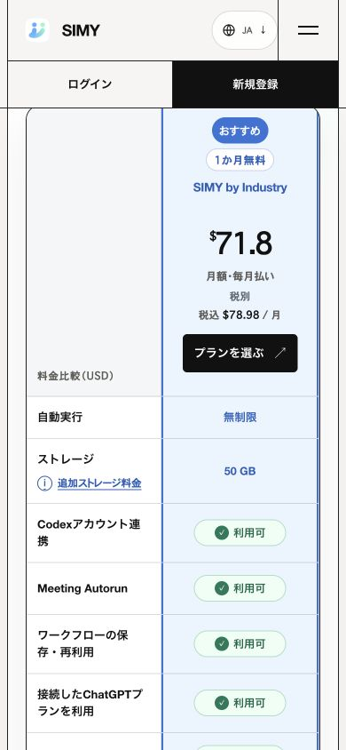
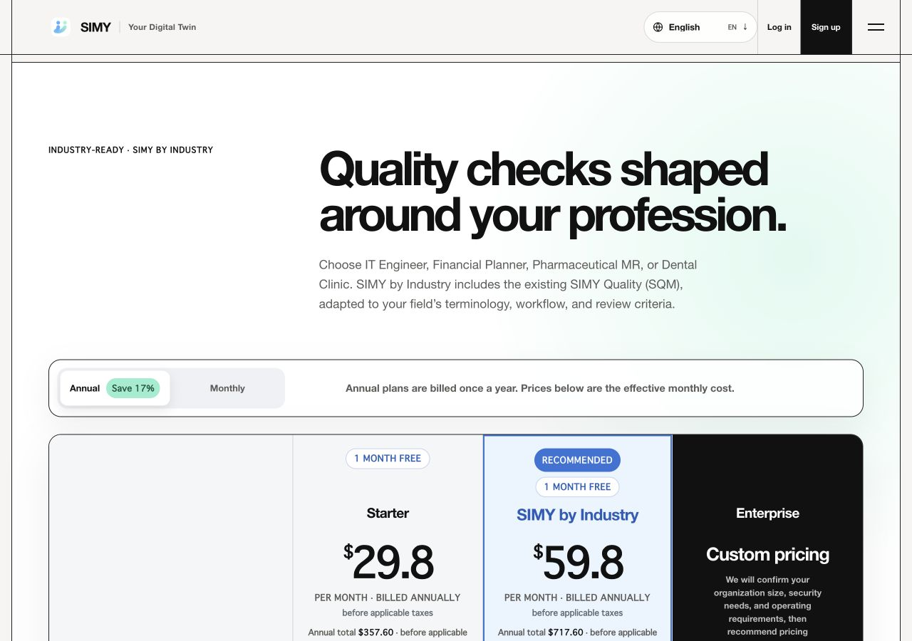

# Dev pricing handoff evidence

Purpose: preserve the existing offer and carry the chosen plan, billing period and language from the comparison table to the Dev signup page.

- Original plan prices, monthly/annual options, free-trial copy and feature descriptions are unchanged.
- `dev.simy.one` and local previews route app links to `app-dev.simy.one`; production keeps `app.simy.one`.
- 66 Node tests passed (`node --test tests/*.test.cjs tests/pricing-static.test.mjs`).
- CUA browser checks: 390px Japanese monthly ($35.80/$71.80; tax-inclusive $39.38/$78.98), 1280px English annual ($29.80/$59.80 monthly equivalents; annual $357.60/$717.60), and exact plan/interval/language query parameters.
- Independent review ran all 5 Playwright cases successfully with cached Chromium: Japanese/English at 390/1280px and an in-page language switch preserving the monthly selection.
- Dev deployment binds HTML app links to app-dev before upload, including no-JavaScript fallback; the reviewer verified zero production app links remain in transformed HTML. Production deployment does not perform this transform.
- This is homepage handoff evidence only. It does not prove authentication, Stripe Checkout or post-payment entitlement behavior. Those remain companion Dev application/backend release gates.

Release: merge to Dev after companion signup flow is verified. Production is outside this release. Rollback: revert the handoff changes; no pricing/catalog data changed.

## Review refresh — 2026-10-16

- Integrated current `dev` (`4c638c3`), retaining its purchase-availability copy and pricing selection implementation. The remaining runtime delta selects the Dev application host and preserves locale updates for links already rewritten by deployment.
- Re-ran all Node tests: 1,105 passed, zero skipped. The localized bundle check and `git diff --check` passed.
- Chromium: seven cases passed. Four cover Japanese/English at 390/1280px with both billing intervals and both plans; one covers monthly selection through a locale change; two serve local repository files under simulated production/Dev hostnames and switch through all six locales. These host tests make no external application requests.
- Executed the workflow's exact Dev HTML transform in a temporary site copy and checked that production app links were absent afterward. The production source remained unchanged.
- The existing CI workflow now runs all Node tests and the pricing handoff Chromium suite. Current CI results are recorded on the PR after pushing.
- The screenshots above are historical October 1 evidence. No layout or prices changed in this refresh. This still does not establish provider login, real Stripe Checkout, entitlement delivery or deployed acceptance.
